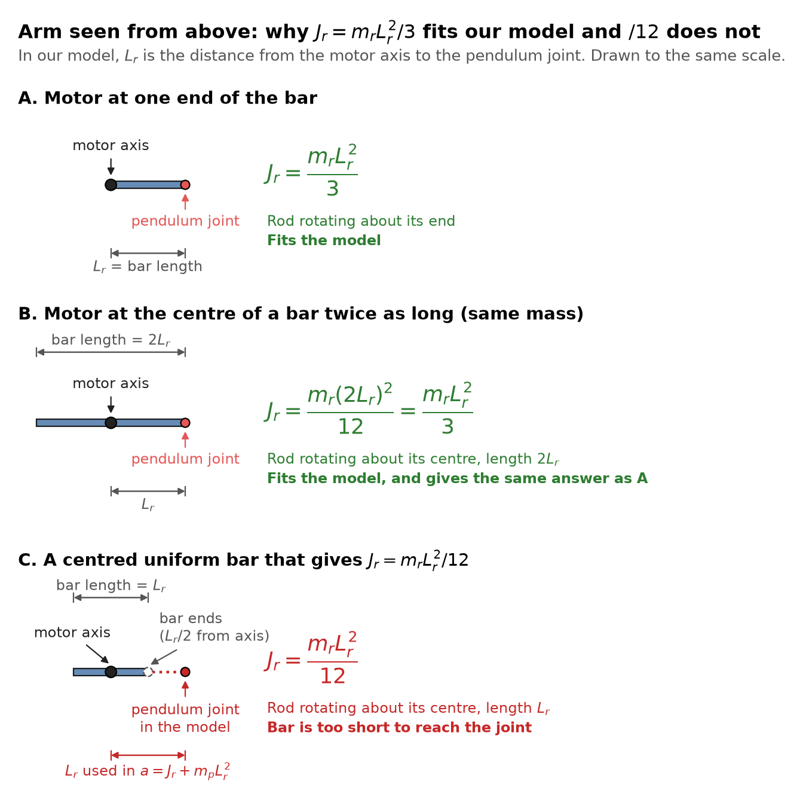

# 02: System Model (Lab 9 A1)

## 1. Physical system and signals

A DC motor rotates a horizontal arm of length L_r. A pendulum of length L_p hangs from a free joint at the arm tip. The pendulum swings in the plane perpendicular to the arm. Both joints have encoders.

| Signal | Symbol | Unit | Role |
| --- | --- | --- | --- |
| Motor voltage | V_m | V | **Input** u (the only actuator) |
| Arm angle | θ | rad | State x₁ and measured output y₁ (motor encoder) |
| Pendulum angle | α | rad | State x₂ and measured output y₂ (pendulum encoder) |
| Arm angular velocity | θ̇ | rad/s | State x₃, **not measured** |
| Pendulum angular velocity | α̇ | rad/s | State x₄, **not measured** |
| Disturbance torque on arm (cable drag, friction) | τ_d | N·m | Disturbance (step or constant) |
| Disturbance torque on pendulum (a tap or push) | τ_p | N·m | Disturbance (impulse) |
| Encoder quantisation and noise | n | rad | Measurement disturbance |

**Conventions:**

- θ is positive counter-clockwise when viewed from above.
- **α = 0 is upright** and α = π is hanging down. α is positive when the pendulum leans *backwards*, opposite to the direction of positive arm rotation. Viewed from the motor looking outward along the arm, that is clockwise. This sign is what gives the −½ m_p L_p L_r cos α coupling term below. It is also why a positive voltage makes both θ and α increase: the pendulum lags behind the accelerating arm.

## 2. Nonlinear equations of motion

The equations of motion come from **Lagrangian mechanics** [4, 5]. This section derives them from scratch so that every term can be traced to its source. Reference numbers in square brackets point to §7.

**Result** (derived in §2.1–2.9 and implemented in `matlab/furuta_nl.m`):

$$
\left(J_r + m_p L_r^2 + \left(J_p + \tfrac14 m_p L_p^2\right)\sin^2\alpha\right)\ddot\theta
- \tfrac12 m_p L_p L_r \cos\alpha\,\ddot\alpha
+ 2\left(J_p + \tfrac14 m_p L_p^2\right)\sin\alpha\cos\alpha\,\dot\theta\dot\alpha
+ \tfrac12 m_p L_p L_r \sin\alpha\,\dot\alpha^2
= \tau - D_r\dot\theta + \tau_d \tag{M14}
$$

$$
-\tfrac12 m_p L_p L_r \cos\alpha\,\ddot\theta
+ \left(J_p + \tfrac14 m_p L_p^2\right)\ddot\alpha
- \left(J_p + \tfrac14 m_p L_p^2\right)\cos\alpha\sin\alpha\,\dot\theta^2
- \tfrac12 m_p g L_p \sin\alpha
= -D_p\dot\alpha + \tau_p \tag{M17}
$$

$$
\tau = \frac{k_m}{R_m}\left(V_m - k_m\dot\theta\right) \tag{M20}
$$

These are the form used in the Quanser rotary pendulum workbook [2]. They are a simplified special case of the full model derived by Cazzolato & Prime [1]; §2.11 lists exactly what is simplified.

### 2.1 Modelling assumptions

| # | Assumption | Justification | Source |
| --- | --- | --- | --- |
| A1 | Both links are rigid bodies | Aluminium arm and pendulum; deflection is negligible at these loads | Standard rigid-body modelling [4, 5] |
| A2 | The pendulum is a uniform slender rod: no inertia about its own long axis | Its diameter (a few mm) is small compared with L_p = 129 mm | [1] discusses this simplification |
| A3 | The arm stays horizontal and rotates about a vertical axis | It is fixed to the motor shaft | Geometry of the device [2, 3] |
| A4 | Joint friction is viscous, i.e. torque = −D × (relative angular velocity) | The simplest linear friction model; Coulomb friction is ignored | Rayleigh dissipation [4] Ch. 1 |
| A5 | Motor inductance is negligible | The electrical time constant L_m/R_m is well under 1 ms, much faster than the mechanics | DC motor model [6] Ch. 2 |
| A6 | The motor drives the arm directly, with no gearbox | QUBE-Servo 2 is direct-drive | [2] |
| A7 | The arm is a uniform bar with the motor at one end, so J_r = m_rL_r²/3 | Consistent with L_r being the motor-axis-to-joint distance; see §4.1 | Rod about its end [7, Ch. 17] |

### 2.2 Generalised coordinates

The system is two rigid bodies, each with one rotational joint, so it has **two degrees of freedom** [5, Ch. 7]. Choose the generalised coordinates

$$
q = \begin{bmatrix} \theta & \alpha \end{bmatrix}^T \tag{M1}
$$

Here θ is the arm angle, measured from a fixed reference. α is the pendulum angle measured from upright, *relative to the arm*.

**Where it comes from:** Lagrange's method needs one independent coordinate per degree of freedom. Measuring α relative to the arm makes the joint constraint automatic, so no constraint forces need to be computed. That is the main advantage of Lagrange over Newton–Euler.

### 2.3 Kinematics: where the pendulum's mass is and how fast it moves

Use a rotating frame attached to the arm, with unit vectors:

- e_r = (cos θ, sin θ, 0), along the arm;
- e_t = (−sin θ, cos θ, 0), horizontal and perpendicular to the arm;
- e_z, vertical.

As the arm turns, they change at the rates ė_r = θ̇ e_t and ė_t = −θ̇ e_r.

Let l = L_p/2 be the distance from the pivot to the pendulum's centre of mass (A2: uniform rod). With α = 0 upright and positive α leaning towards −e_t (§1 conventions), the centre of mass is at

$$
\mathbf{p} = L_r\,\mathbf{e}_r - l\sin\alpha\,\mathbf{e}_t + l\cos\alpha\,\mathbf{e}_z \tag{M2}
$$

**Where it comes from:** geometry. The arm tip is at L_r e_r. The pendulum then reaches l along its own axis, which is tilted by α from vertical in the plane perpendicular to the arm (A3).

Differentiate (M2), using the rates of change of the unit vectors:

$$
\dot{\mathbf{p}} = l\sin\alpha\,\dot\theta\,\mathbf{e}_r + \left(L_r\dot\theta - l\cos\alpha\,\dot\alpha\right)\mathbf{e}_t - l\sin\alpha\,\dot\alpha\,\mathbf{e}_z \tag{M3}
$$

The three components are orthogonal, so the squared speed is the sum of their squares:

$$
|\dot{\mathbf{p}}|^2 = L_r^2\dot\theta^2 - 2L_r l\cos\alpha\,\dot\theta\dot\alpha + l^2\dot\alpha^2 + l^2\sin^2\alpha\,\dot\theta^2 \tag{M4}
$$

**Where it comes from:** the chain rule on (M2), then Pythagoras on (M3), using sin² + cos² = 1 to combine the α̇² terms. Each term has a physical meaning:

- L_r²θ̇²: the pendulum is carried around by the arm.
- −2L_r l cos α θ̇α̇: coupling between arm and pendulum motion. Its sign comes from the α convention.
- l²α̇²: the pendulum swinging.
- l² sin²α θ̇²: a leaning pendulum sweeps a wider circle as the arm turns.

### 2.4 Energies

**Arm kinetic energy.** The arm is a rigid body rotating about a fixed axis [7, Ch. 18]:

$$
T_r = \tfrac12 J_r\dot\theta^2 \tag{M5}
$$

J_r is the arm's moment of inertia about the motor axis. We model the arm as a uniform bar with the motor at one end, so J_r = m_rL_r²/3 (assumption A7, §4.1).

**Pendulum kinetic energy.** König's theorem splits a rigid body's kinetic energy into two parts: translation of its centre of mass, plus rotation about its centre of mass [4, Ch. 5].

The pendulum's angular velocity is ω = θ̇ e_z + α̇ e_r. For a slender rod (A2), only the components of ω perpendicular to the rod store energy. Those components have magnitude² α̇² + sin²α θ̇². So

$$
T_p = \tfrac12 m_p|\dot{\mathbf{p}}|^2 + \tfrac12 J_p\left(\dot\alpha^2 + \sin^2\alpha\,\dot\theta^2\right) \tag{M6}
$$

**Where it comes from:** J_p = m_pL_p²/12 is the inertia of a uniform rod about its centre, from J = ∫r² dm [7, Ch. 17]. The J_p sin²α θ̇² part is the pendulum's rotation about its own centre as the arm turns; Gäfvert [8] and the QUBE-Servo 2 model in Xu et al. [9] both keep it.

**Potential energy.** Only the pendulum's height changes (A3). From (M2), its centre of mass is at height l cos α:

$$
V = m_p g\,l\cos\alpha \tag{M7}
$$

V is largest at α = 0, which is why upright is an unstable equilibrium.

**The Lagrangian** is defined as L = T − V [4, Ch. 1]. Substitute (M4)–(M7) with l = L_p/2, so that m_p l² = ¼m_pL_p², m_pL_r l = ½m_pL_pL_r and m_p g l = ½m_p g L_p:

$$
\mathcal{L} = \tfrac12\left(J_r + m_pL_r^2 + \left(J_p + \tfrac14 m_pL_p^2\right)\sin^2\alpha\right)\dot\theta^2 - \tfrac12 m_pL_pL_r\cos\alpha\,\dot\theta\dot\alpha + \tfrac12\left(J_p + \tfrac14 m_pL_p^2\right)\dot\alpha^2 - \tfrac12 m_p g L_p\cos\alpha \tag{M8}
$$

Notice that J_p + ¼m_pL_p² appears automatically. This is the **parallel-axis theorem** [7]: the pendulum's inertia about its pivot equals its inertia about its centre plus m_p l².

### 2.5 Generalised forces: everything that is not a conservative force

Non-conservative forces enter through generalised forces Q_q. These are found from the **virtual work** they do, δW = Q_θ δθ + Q_α δα [4, Ch. 1]. Three kinds act:

- **The motor torque τ** acts between the base and the arm, so it does work only through θ.
- **Viscous joint friction** (A4) can be written with Rayleigh's dissipation function, F = ½D_rθ̇² + ½D_pα̇², which gives Q = −∂F/∂q̇ [4, Ch. 1]. α is the *relative* angle at the pendulum joint, so the pendulum friction appears only in the α equation.
- **Disturbances** τ_d (on the arm) and τ_p (on the pendulum) are external torques acting on each coordinate.

$$
Q_\theta = \tau - D_r\dot\theta + \tau_d,\qquad Q_\alpha = -D_p\dot\alpha + \tau_p \tag{M9}
$$

### 2.6 Euler–Lagrange equations

For each generalised coordinate [4, Ch. 1], [5, Ch. 7]:

$$
\frac{d}{dt}\left(\frac{\partial\mathcal{L}}{\partial\dot q}\right) - \frac{\partial\mathcal{L}}{\partial q} = Q_q,\qquad q \in \{\theta, \alpha\} \tag{M10}
$$

**Where it comes from:** Hamilton's principle of stationary action, extended to non-conservative forces by d'Alembert's principle. Physically, (M10) is Newton's second law written in generalised coordinates.

### 2.7 Arm equation (q = θ)

Differentiate (M8) with respect to θ̇. This is the arm's generalised (angular) momentum:

$$
\frac{\partial\mathcal{L}}{\partial\dot\theta} = \left(J_r + m_pL_r^2 + \left(J_p + \tfrac14 m_pL_p^2\right)\sin^2\alpha\right)\dot\theta - \tfrac12 m_pL_pL_r\cos\alpha\,\dot\alpha \tag{M11}
$$

Take its time derivative with the product and chain rules, using d(sin²α)/dt = 2 sin α cos α α̇ and d(cos α)/dt = −sin α α̇:

$$
\frac{d}{dt}\frac{\partial\mathcal{L}}{\partial\dot\theta} = \left(J_r + m_pL_r^2 + \left(J_p + \tfrac14 m_pL_p^2\right)\sin^2\alpha\right)\ddot\theta + 2\left(J_p + \tfrac14 m_pL_p^2\right)\sin\alpha\cos\alpha\,\dot\alpha\dot\theta - \tfrac12 m_pL_pL_r\cos\alpha\,\ddot\alpha + \tfrac12 m_pL_pL_r\sin\alpha\,\dot\alpha^2 \tag{M12}
$$

θ itself does not appear in (M8), because the physics is the same whichever way the arm points. Therefore

$$
\frac{\partial\mathcal{L}}{\partial\theta} = 0 \tag{M13}
$$

Substitute (M12), (M13) and Q_θ from (M9) into (M10). The result is the **arm equation (M14)** given at the top of this section.

| Term in (M14) | Physical meaning |
| --- | --- |
| (J_r + m_pL_r² + (J_p + ¼m_pL_p²) sin²α)θ̈ | Arm inertia, plus the pendulum carried at the tip, plus extra inertia when the pendulum leans out |
| −½m_pL_pL_r cos α α̈ | Inertial coupling: a swinging pendulum pushes back on the arm |
| 2(J_p + ¼m_pL_p²) sin α cos α θ̇α̇ | Coriolis term: the pendulum's radius of rotation changes as it swings |
| ½m_pL_pL_r sin α α̇² | Centripetal reaction of the swinging pendulum on the arm |
| τ − D_rθ̇ + τ_d | Motor torque, friction and disturbance (M9) |

### 2.8 Pendulum equation (q = α)

Differentiate (M8) with respect to α̇, then with respect to time:

$$
\frac{\partial\mathcal{L}}{\partial\dot\alpha} = -\tfrac12 m_pL_pL_r\cos\alpha\,\dot\theta + \left(J_p + \tfrac14 m_pL_p^2\right)\dot\alpha
$$

$$
\frac{d}{dt}\frac{\partial\mathcal{L}}{\partial\dot\alpha} = -\tfrac12 m_pL_pL_r\cos\alpha\,\ddot\theta + \tfrac12 m_pL_pL_r\sin\alpha\,\dot\alpha\dot\theta + \left(J_p + \tfrac14 m_pL_p^2\right)\ddot\alpha \tag{M15}
$$

Differentiate (M8) with respect to α. Three terms of (M8) depend on α:

$$
\frac{\partial\mathcal{L}}{\partial\alpha} = \left(J_p + \tfrac14 m_pL_p^2\right)\sin\alpha\cos\alpha\,\dot\theta^2 + \tfrac12 m_pL_pL_r\sin\alpha\,\dot\theta\dot\alpha + \tfrac12 m_p g L_p\sin\alpha \tag{M16}
$$

Substitute (M15), (M16) and Q_α from (M9) into (M10). The ½m_pL_pL_r sin α θ̇α̇ terms appear in both (M15) and (M16) and **cancel**. The result is the **pendulum equation (M17)** given at the top of this section.

| Term in (M17) | Physical meaning |
| --- | --- |
| −½m_pL_pL_r cos α θ̈ | Accelerating the arm drags the pendulum's pivot sideways. This is how the motor balances the pendulum |
| (J_p + ¼m_pL_p²)α̈ | Pendulum inertia about its pivot (parallel-axis theorem) |
| −(J_p + ¼m_pL_p²) cos α sin α θ̇² | Centrifugal effect: a spinning arm flings a leaning pendulum outward |
| −½m_p g L_p sin α | Gravity torque. With the minus sign on the left-hand side it drives α away from zero, so the upright position is unstable |
| −D_pα̇ + τ_p | Joint friction and disturbance (M9) |

### 2.9 Motor model

**Electrical side.** Kirchhoff's voltage law around the armature circuit [6, Ch. 2]:

$$
V_m = R_m i + L_m\frac{di}{dt} + k_m\dot\theta \tag{M18}
$$

The three terms are the resistive drop, the inductive drop, and the back-EMF. The back-EMF is the voltage generated by the spinning rotor, proportional to speed.

**Mechanical side.** Torque is proportional to current (Lorentz force):

$$
\tau = k_t\,i \tag{M19}
$$

The electrical power absorbed by the back-EMF, k_m θ̇ · i, must equal the mechanical power delivered, τθ̇ = k_t i θ̇. So in SI units k_t = k_m, which is why the model has a single constant k_m [6].

**Combining them.** With L_m neglected (A5), (M18) gives i = (V_m − k_mθ̇)/R_m. Substituting into (M19) gives the motor equation **(M20)** at the top of this section.

(M20) is why the back-EMF appears later as extra damping, B_eq = D_r + k_m²/R_m (§3): the term −(k_m²/R_m)θ̇ has exactly the same form as viscous friction.

### 2.10 Matrix form, as implemented in code

(M14) and (M17) can be written in the standard manipulator form [5, Ch. 7]:

$$
\underbrace{\begin{bmatrix} J_r + m_pL_r^2 + \left(J_p + \tfrac14 m_pL_p^2\right)\sin^2\alpha & -\tfrac12 m_pL_pL_r\cos\alpha \\ -\tfrac12 m_pL_pL_r\cos\alpha & J_p + \tfrac14 m_pL_p^2 \end{bmatrix}}_{M(\alpha)}
\begin{bmatrix} \ddot\theta \\ \ddot\alpha \end{bmatrix} = f(\alpha, \dot\theta, \dot\alpha, V_m, \tau_d, \tau_p) \tag{M21}
$$

M(α) is the mass (inertia) matrix: every term in (M14) and (M17) multiplied by an acceleration. f collects all the remaining terms, moved to the right-hand side.

M(α) is symmetric and positive definite, because the kinetic energy ½q̇ᵀMq̇ is positive for any motion. So it is always invertible.

`furuta_nl.m` builds M and f, then solves for the accelerations with `M\f`.

### 2.11 How this compares with the literature

- **Cazzolato & Prime [1]** derive the *full* Furuta pendulum dynamics, both by Lagrange and by Newton–Euler. They allow general inertia tensors for both links. They show that under simplifying assumptions the model reduces to the forms commonly used in the literature, and they demonstrate the effect of the usually neglected inertia terms.

  Our model is such a simplified case: a slender pendulum (A2) and the arm inertia lumped into J_r (A7). Their angle definitions and sign conventions may differ from ours (§1), so convert before comparing term by term.
- **Quanser workbook [2]** has not been read directly. The QUBE-Servo 2 model that Xu et al. [9] attribute to it uses the same equations as ours and lists J_r = 2.3060 × 10⁻⁴ kg·m² including the pendulum mass, which corresponds to `/12` for the arm. See doc 10 §3 for how that compares with our J_r.
- **Furuta et al. [3]** introduced the device. It is cited for context, not for these equations.

## 3. Linearisation about the upright equilibrium

**Equilibrium:** x̄ = [θ̄, 0, 0, 0] with ū = 0. Any θ̄ is an equilibrium, so choose θ̄ = 0. Linearise using sin α ≈ α and cos α ≈ 1, and drop products of small terms (sin²α, θ̇α̇, α̇², θ̇²).

Define the lumped constants:

$$
a = J_r + m_p L_r^2,\quad b = \tfrac12 m_p L_p L_r,\quad c = J_p + \tfrac14 m_p L_p^2,\quad d = \tfrac12 m_p g L_p,\quad \Delta = ac - b^2,\quad B_{eq} = D_r + \frac{k_m^2}{R_m}
$$

The linearised equations are

$$
a\ddot\theta - b\ddot\alpha = \tfrac{k_m}{R_m}V_m - B_{eq}\dot\theta, \qquad
-b\ddot\theta + c\ddot\alpha - d\alpha = -D_p\dot\alpha
$$

Solving for θ̈ and α̈ gives ẋ = Ax + Bu, y = Cx + Du:

$$
A = \begin{bmatrix} 0 & 0 & 1 & 0 \\ 0 & 0 & 0 & 1 \\ 0 & \frac{bd}{\Delta} & -\frac{cB_{eq}}{\Delta} & -\frac{bD_p}{\Delta} \\ 0 & \frac{ad}{\Delta} & -\frac{bB_{eq}}{\Delta} & -\frac{aD_p}{\Delta} \end{bmatrix},\quad
B = \frac{k_m}{R_m\Delta}\begin{bmatrix} 0 \\ 0 \\ c \\ b \end{bmatrix},\quad
C = \begin{bmatrix} 1 & 0 & 0 & 0 \\ 0 & 1 & 0 & 0 \end{bmatrix},\quad
D = \begin{bmatrix} 0 \\ 0 \end{bmatrix}
$$

Numerical values with the nominal parameters (from `furuta_linmodel.m`):

$$
A = \begin{bmatrix} 0 & 0 & 1 & 0 \\ 0 & 0 & 0 & 1 \\ 0 & 55.153 & -6.2835 & -1.8159 \\ 0 & 168.58 & -6.2104 & -5.5506 \end{bmatrix},\qquad
B = \begin{bmatrix} 0 \\ 0 \\ 18.373 \\ 18.159 \end{bmatrix}
$$

The positive gravity entries A(3,2) and A(4,2) cause the instability.

## 4. Parameters

| Parameter | Symbol | Value | Unit | Source / note |
| --- | --- | --- | --- | --- |
| Motor resistance | R_m | 8.4 | Ω | [9], [11] |
| Torque / back-EMF constant | k_m = k_t | 0.042 | N·m/A | [9], [11] |
| Arm mass | m_r | 0.095 | kg | Not yet confirmed by an opened source (doc 10 §3) |
| Arm length | L_r | 0.085 | m | [9] |
| Arm inertia | J_r = m_r L_r²/3 | 2.29 × 10⁻⁴ | kg·m² | Uniform bar, motor at one end (§4.1) |
| Pendulum mass | m_p | 0.024 | kg | [9] |
| Pendulum length | L_p | 0.129 | m | [9] |
| Pendulum inertia (about CoM) | J_p = m_p L_p²/12 | 3.33 × 10⁻⁵ | kg·m² | Uniform rod |
| Arm damping | D_r | 0.0005 | N·m·s/rad | Published QUBE-Servo 2 value [9]; uncertain |
| Pendulum damping | D_p | 0.0001 | N·m·s/rad | Published QUBE-Servo 2 value [9]; uncertain |
| Voltage limit | V_max | ±10 | V | Conservative design limit, inside the ±15 V drive range [10] and the 18 V motor rating [11] |
| Encoder resolution | — | 2048 counts/rev (3.07 mrad) | — | Datasheet parts, doc 08 |
| Gravity | g | 9.81 | m/s² | — |

If any value changes, edit only `furuta_params.m`; everything else is computed from it.

### 4.1 Arm geometry assumption

**We assume the arm is a uniform bar with the motor at one end and the pendulum joint at the other (case A in the figure).** So:

$$
J_r = \int_0^{L_r} r^2\,\frac{m_r}{L_r}\,dr = \frac{m_r L_r^2}{3}
$$

**Why this matters.** In this model L_r is the distance from the motor axis to the pendulum joint, because a = J_r + m_pL_r² places the pendulum mass at that distance. The bar must therefore reach the joint:

- **Case A** (motor at one end, bar length L_r) gives m_rL_r²/3. This is the case we model.
- **Case B** (motor at the centre, bar length 2L_r, same mass) gives m_r(2L_r)²/12, also m_rL_r²/3.
- **Case C** (J_r = m_rL_r²/12) needs a centred bar only L_r long, which ends at L_r/2 and never reaches the joint. It is inconsistent with this model.

For a uniform bar reaching the joint with the motor anywhere between cases A and B, J_r lies between m_rL_r²/4 and m_rL_r²/3.

**Limitations.** A real arm is not uniform, and the motor rotor and hub add inertia that this assumption leaves out. Published QUBE-Servo 2 values also differ: Xu et al. list a total arm inertia that corresponds to `/12` (doc 10 §3). The nominal design is tested on that value in `week12_margins.m`. A measured value should replace this assumption if one becomes available.

## 5. Model properties (verified in MATLAB)

| Property | Result | Meaning |
| --- | --- | --- |
| Open-loop poles | 0, −17.73, **+9.96**, −4.06 rad/s | Unstable. The time constant is 100 ms; from 2° the pendulum passes 15° in 0.26 s |
| Reachability | rank 4 / 4 | All poles can be placed with V_m |
| Observability (θ, α) | rank 4 / 4 | An observer can estimate θ̇ and α̇ |
| Observability (θ only) | rank 4 / 4 | θ alone is enough in theory; α improves conditioning |
| Observability (α only) | rank 3 / 4 | θ cannot be recovered from α (θ is a free integrator) |
| Zeros of θ / V_m | **+8.97**, −12.72 rad/s | Non-minimum phase: the arm initially moves the wrong way, which limits θ tracking bandwidth |
| cond(ctrb) | ≈ 3 × 10⁴ | Use `place`/`lqr`, not Ackermann by hand |

### Sensitivity of the unstable pole to ±20% parameter error

| Parameter | × 0.8 | × 1.2 |
| --- | --- | --- |
| m_p | 9.31 | 10.48 |
| L_p | 10.32 | 9.51 |
| L_r | 9.79 | 10.08 |
| R_m | 9.95 | 9.96 |
| k_m | 9.97 | 9.94 |
| D_r | 10.02 | 9.90 |
| D_p | 10.37 | 9.56 |

The unstable pole stays between 9.3 and 10.5 rad/s, so the model is structurally robust. The pendulum mass and the damping coefficients matter most.

## 6. Open-loop simulations (Lab 9 A2)

Generated by `week9_model_and_openloop.m`:

- `figures/w9_openloop_release.png`: release from α₀ = 2°. The linear and nonlinear responses agree up to about 15°, then diverge. The nonlinear pendulum falls and swings to hanging (α = 180°) instead of growing without bound.
- `figures/w9_pulse_response.png`: 1 V, 50 ms voltage pulse from upright. A pulse this small is enough to topple the pendulum. Linear and nonlinear responses agree until α ≈ 15°. After that, the nonlinear arm reverses as the pendulum falls, while the linear arm diverges.

## 7. References

1. B. S. Cazzolato and Z. Prime, "On the Dynamics of the Furuta Pendulum," *Journal of Control Science and Engineering*, vol. 2011, Article ID 528341, 8 pp., 2011. [doi:10.1155/2011/528341](https://doi.org/10.1155/2011/528341). Open access via the [University of Adelaide repository](https://hdl.handle.net/2440/66777).
2. J. Apkarian, P. Karam and M. Lévis, *Rotary Pendulum Workbook (Student)*, QUBE-Servo 2, Quanser Inc. Available through the Quanser Academic Portal or your instructor. **Not independently verified for this report**: check the equations and parameter values against your copy before citing.
3. K. Furuta, M. Yamakita and S. Kobayashi, "Swing-up control of inverted pendulum using pseudo-state feedback," *Proc. IMechE Part I: Journal of Systems and Control Engineering*, vol. 206, no. 4, pp. 263–269, 1992.
4. H. Goldstein, C. Poole and J. Safko, *Classical Mechanics*, 3rd ed. Addison-Wesley, 2002. Ch. 1 (Lagrange's equations, generalised forces, Rayleigh dissipation function), Ch. 5 (rigid-body kinetic energy).
5. M. W. Spong, S. Hutchinson and M. Vidyasagar, *Robot Modeling and Control*. Wiley, 2006. Ch. 7 (Euler–Lagrange equations, inertia-matrix form).
6. G. F. Franklin, J. D. Powell and A. Emami-Naeini, *Feedback Control of Dynamic Systems*. Pearson. Ch. 2 (DC motor model, k_t = k_e).
7. R. C. Hibbeler, *Engineering Mechanics: Dynamics*. Pearson. Ch. 17 (moments of inertia, parallel-axis theorem), Ch. 18 (kinetic energy of rigid bodies).

8. M. Gäfvert, "Modelling the Furuta Pendulum," Tech. Rep. TFRT-7574, Lund Inst. Technol., 1998. Read.
9. J. Xu, Y. Tan and X. Chen, "Robust Tracking Control for Nonlinear Systems: Performance optimization via extremum seeking," arXiv:2304.00138, 2023. Section V read.
10. Quanser, [QUBE-Servo 2 USB documentation](https://docs.quanser.com/quarc/documentation/qube_servo2_usb.html): ±15 V drive range, ±3 A current sense, 4× quadrature. Read.
11. Allied Motion, [CL Series datasheet](https://www.alliedmotion.com/wp-content/uploads/documents/Allied_Motion_Datasheet-CLSeries_20171002.pdf), CL40 model 16705. Read. Its 8.4 Ω and 42 mN·m/A match the QUBE values exactly, but no source opened says the QUBE uses this motor.

Chapter numbers are for the editions named. Check them against the edition your library holds.
