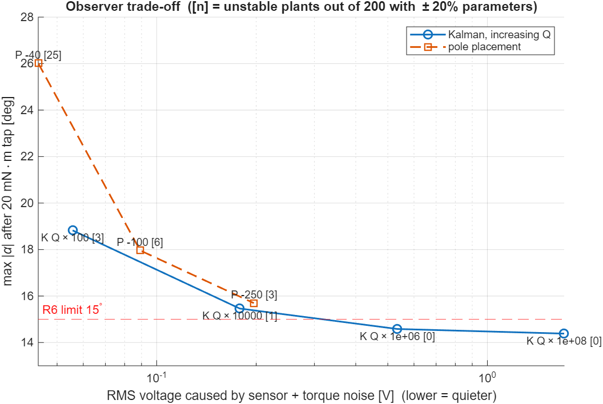

# 09: Investigation of a Kalman Filter as the Observer

**Result:** a steady-state Kalman filter is a better observer for this plant than any pole-placed observer we tried, provided its process-noise covariance Q is set to the size of the torques the model *doesn't* know about, not just the small random noise. For the same disturbance response, Kalman gains give less voltage noise and keep more randomly perturbed plants stable (Figure `w11_kalman_tradeoff.png`, table in §5).

A Kalman filter tuned only to the small random noise ("matched") lets the pendulum fall after a firm tap. It trusts the model too much.

**Decision needed (LOGBOOK D-12):** keep the pole-placed observer as the assessed design, with the Kalman filter as an extension, or adopt a Kalman gain as the main observer. See §6.

Code: [week11_kalman.m](../matlab/week11_kalman.m). Equations are numbered (K1)–(K14).

---

## 1. Why consider a Kalman filter

The pole-placed observer (doc 04 §4) forces one trade-off:

| Observer poles | Velocity-estimate noise | Reaction to a sudden disturbance | Robustness to ±20% parameter errors |
| --- | --- | --- | --- |
| Slow (−15) | Low | Very slow; pendulum falls after a tap | 48/200 plants unstable |
| Fast (−250) | High | Fast | 3/200 unstable |

Choosing poles is guesswork about this balance. The Kalman filter instead chooses the observer gain L from **explicit models of the two noise sources**:

- how uncertain the *model* is (process noise, Q);
- how uncertain the *sensors* are (measurement noise, R).

It then gives the gain that minimises the estimation-error variance. We already have a datasheet-based model for R (doc 08). That leaves one physically meaningful tuning question: how big are the torques we haven't modelled?

---

## 2. Where the Kalman filter comes from (recursive least squares)

The MIT 6.241J notes (Dahleh, Dahleh & Verghese [2], Ch. 2 §2.6) derive the Kalman gain without any probability, as **recursive least squares (RLS)**.

Suppose measurements yᵢ = Aᵢx + eᵢ arrive one at a time, and we want the estimate x̂ₖ that minimises the weighted squared error Σ eᵢ′ Sᵢ eᵢ. Then the new estimate is the old one plus a correction:

$$
\hat{x}_{k+1} = \hat{x}_k + \underbrace{Q_{k+1}^{-1}A_{k+1}'S_{k+1}}_{\text{Kalman gain}}\;\underbrace{\left(y_{k+1} - A_{k+1}\hat{x}_k\right)}_{\text{innovation}} \tag{K1}
$$

$$
Q_{k+1} = Q_k + A_{k+1}'S_{k+1}A_{k+1} \tag{K2}
$$

**Where it comes from:** [2] eqs. after (2.3). The notes name the gain and the *innovation* (what the new data says that the old estimate didn't predict). They also show that P = Q⁻¹ obeys a discrete-time **Riccati equation**.

They note one problem: for a *constant* x, the gain shrinks to zero as data accumulates, and the estimator "goes to sleep". The Kalman filter fixes this for a *changing* state. Between measurements the state moves according to the dynamics, and **process noise** adds fresh uncertainty, so the gain never vanishes. [2] Exercise 2.7 builds exactly this for a rotating machine whose angle is measured. That is our encoder problem in miniature.

The probabilistic version is Kalman's original paper [1]. With Gaussian noise it is the best possible estimator; with any noise of the stated covariances, it is the best *linear* one.

---

## 3. The noise model for the Furuta pendulum

### 3a. Discrete-time plant with noise

$$
x_{k+1} = A_d x_k + B_d u_k + G_d w_k,\qquad y_k = C x_k + v_k \tag{K3}
$$

| Symbol | Meaning | Value / source |
| --- | --- | --- |
| A_d, B_d | Plant sampled with zero-order hold at T_s = 1 ms | `c2d` of doc 02's A, B |
| C | Picks θ and α | [I₂ 0] |
| w_k = [τ_d, τ_p]ᵀ | Unknown torques on the arm and pendulum, held over each sample | Process noise |
| v_k | Encoder error | Measurement noise (doc 08) |
| G_d | How a torque moves the state over one sample | (K4)–(K5) |

**Where it comes from:** (E1) of doc 06, sampled, with unknown torques and sensor errors added.

### 3b. How a torque enters the state: G

At upright, the linearised equations of motion (doc 02 §3) with torques τ_d on the arm and τ_p on the pendulum are

$$
\underbrace{\begin{bmatrix} a & -b \\ -b & c \end{bmatrix}}_{M_0}\begin{bmatrix}\ddot\theta \\ \ddot\alpha\end{bmatrix} = (\text{terms in } x \text{ and } u) + \begin{bmatrix}\tau_d \\ \tau_p\end{bmatrix}
\;\Rightarrow\;
G = \begin{bmatrix} 0 & 0 \\ 0 & 0 \\ c/\Delta & b/\Delta \\ b/\Delta & a/\Delta \end{bmatrix} \tag{K4}
$$

**Where it comes from:** multiply through by M₀⁻¹ = (1/Δ)[c b; b a]. A torque changes only the accelerations (rows 3–4), never the angles directly. Numerically G(3:4,:) = [9946 9830; 9830 17227] rad/s² per N·m.

Because the noise is held constant over each sample (as in the simulation),

$$
G_d = \int_0^{T_s} e^{A\eta}\,d\eta\; G \tag{K5}
$$

**Where it comes from:** the zero-order-hold discretisation, the same formula as for B_d. Computed with `c2d(ss(A, G, C, 0), Ts)`.

### 3c. Covariances

$$
Q_w = \mathrm{E}[w_k w_k'] = \mathrm{diag}(\sigma_d^2, \sigma_p^2),\qquad R = \mathrm{E}[v_k v_k'] = \frac{q^2}{12}I_2 = 7.84\times10^{-7}\,I_2\ \text{rad}^2 \tag{K6}
$$

- **R** comes straight from the encoder resolution (doc 08, eq. S2). It is not a tuning knob.
- **Q_w** is the tuning knob. The "matched" value is the random torque noise used in validation V5: σ_d = 0.2 mN·m and σ_p = 0.05 mN·m. Scaling it up says "there are bigger torques we haven't modelled": taps, friction, parameter error.

The standard assumptions are zero-mean white noise, w and v uncorrelated with each other and with x₀. They are approximations here. Quantisation is not white when the pendulum is nearly still (doc 08 §3), and a tap is not white noise at all. §5 shows what this costs.

---

## 4. The filter equations

**Predictor form** (the same structure as our Luenberger observer, so it drops straight into `furuta_sim_obs`):

$$
\hat{x}_{k+1|k} = A_d\hat{x}_{k|k-1} + B_d u_k + L_k\left(y_k - C\hat{x}_{k|k-1}\right) \tag{K7}
$$

$$
L_k = A_d P_k C'\left(C P_k C' + R\right)^{-1} \tag{K8}
$$

$$
P_{k+1} = A_d P_k A_d' + G_d Q_w G_d' - A_d P_k C'\left(C P_k C' + R\right)^{-1} C P_k A_d' \tag{K9}
$$

**Where it comes from:** the standard discrete Kalman filter [1, 3]. Here P_k = E[(x_k − x̂_{k|k−1})(·)′] is the covariance of the prediction error. (K9) is the Riccati equation. It is the dynamic version of the RLS recursion for Q⁻¹ in [2] §2.6, plus the A_d P A_d′ + G_d Q_w G_d′ "prediction" term that adds uncertainty each step.

**Steady state.** The plant is time-invariant, so P_k converges to a constant P. That P solves the discrete algebraic Riccati equation (DARE):

$$
P = A_d P A_d' + G_d Q_w G_d' - A_d P C'\left(C P C' + R\right)^{-1} C P A_d' \tag{K10}
$$

$$
L = A_d P C'\left(C P C' + R\right)^{-1} \tag{K11}
$$

**Where it comes from:** setting P_{k+1} = P_k in (K9). A unique stabilising P exists if (A_d, C) is detectable and (A_d, G_d Q_w^{1/2}) is stabilisable [3]. Both hold: the system is observable (rank 4, doc 02 §5), and G_d drives all four states.

**Duality with LQR.** (K10) is the same equation LQR solves, with A → A_d′, B → C′, Q → G_dQ_wG_d′, R → R. That is why the code calls `idare(Ad', C', Gd*Qw*Gd', R)`. The estimation problem is the "transpose" of the control problem.

**Checks in the code:**

- L from (K11) matches MATLAB's `kalman()` to 9 × 10⁻¹⁴.
- With the matched Q_w, the predicted steady-state error standard deviations are: θ: 0.18 mrad; α: 0.19 mrad; θ̇: 8.1 mrad/s; α̇: 8.5 mrad/s.

  The angle errors are **smaller than the sensor's own σ_v = 0.89 mrad**. The filter averages the model and the measurements, which is the point of using it.

---

## 5. Results: Kalman vs pole placement

Each observer was tested with the same controller (D2 + integrator, type-1 servo) on the nonlinear plant with quantised encoders:

- **Noise test:** random torques σ = [0.2, 0.05] mN·m for 5 s. Measures RMS voltage and RMS α̇-estimate error.
- **Tap test:** 20 mN·m for 20 ms on the pendulum. Measures max |α|.
- **Robustness:** the linear sampled loop on 200 random plants with all 8 parameters ±20%. Counts unstable plants.

Kalman rows scale Q_w by s², i.e. σ scaled by s.

| Observer | Slowest observer pole (rad/s) | RMS u (V) | RMS α̇ error (deg/s) | Tap: max \|α\| | Tap: max \|u\| (V) | Unstable / 200 |
| --- | --- | --- | --- | --- | --- | --- |
| Kalman, Q × 0.09 | −9.1 | 0.025 | 0.58 | **falls** (149°) | 10.0 | 41 |
| Kalman, Q × 1 (matched) | −13.2 ± 11.0j | 0.029 | 0.85 | **falls** (287°) | 10.0 | 20 |
| **Kalman, Q × 100** (σ_d = 2 mN·m) | −38.1 | **0.056** | 2.75 | 18.8° | 5.27 | **3** |
| **Kalman, Q × 10⁴** (σ_d = 20 mN·m) | −119.5 | 0.178 | 9.54 | 15.5° | 5.23 | **1** |
| Kalman, Q × 10⁶ | −375.5 | 0.534 | 32.9 | **14.6°** | 5.44 | 0 |
| Kalman, Q × 10⁸ | −242.7 | 1.707 | 134 | 14.4° | 10.0 | 0 |
| Poles −15…−18 | −15 | 0.026 | 0.60 | falls (150°) | 10.0 | 48 |
| Poles −40…−55 | −40 | 0.044 | 1.01 | 26.0° | 5.71 | 25 |
| **Poles −100…−130 (current design)** | −100 | 0.089 | 2.53 | 18.0° | 5.32 | 6 |
| Poles −250…−280 | −250 | 0.197 | 7.01 | 15.7° | 5.26 | 3 |

### What the results show

1. **The Kalman curve dominates.** Compare neighbours on the plot.
   - Kalman Q×100 vs poles −100: 37% less voltage noise (0.056 vs 0.089 V), half the unstable plants (3 vs 6), and almost the same tap response (18.8° vs 18.0°).
   - Kalman Q×10⁴ vs poles −250: better on all three measures.

   The Kalman gain gives every measurement channel and state its own weight according to how noise actually enters (through G). Pole placement just picks four speeds.
2. **"Optimal" is only optimal for the stated noise.** The matched filter (Q×1) assumes torques of about 0.2 mN·m. A 20 mN·m tap is 100× larger, so the filter treats the measured angle change as sensor noise and reacts too late; the pendulum falls. **Q has to cover everything unmodelled**: taps, friction, and parameter error.
3. **A physically sensible Q exists.** Q×10⁴ means "expect unknown torques of about 20 mN·m on the arm and 5 mN·m on the pendulum", the size of the tap we test with. It gives:
   - tap response 15.5°, just above the R6 limit;
   - 1 unstable plant out of 200;
   - voltage noise 0.18 V RMS (about 2% of the 10 V range).
4. **R6 (≤ 15°) is only met at Q×10⁶, at 0.53 V RMS noise.** That is probably too much chatter for a real motor. Every observer is slower than full-state feedback (14.1° in the same test, LOGBOOK), so the tap requirement is fundamentally tight for an observer-based design. Either relax R6 with a justification, or add disturbance estimation (§7).
5. **Matched Q does not minimise the α̇ error in simulation.** The slow pole-placed observer gets 0.60 deg/s against 0.85 deg/s. The Kalman filter minimises the total error variance *under its assumptions*, and two of those are broken here: quantisation near rest is not white, and the plant is nonlinear and in closed loop. This is worth one sentence in the report as an honest limitation.

---

## 6. Recommendation and decision (D-12)

| Option | Observer | For | Against |
| --- | --- | --- | --- |
| **A** | Keep poles −100…−130 as the assessed design; present Kalman as an extension / innovation section | "Observer-based state feedback as learned in this unit" is unambiguously met; the Kalman section shows initiative | Not the best design we found |
| **B** | Adopt Kalman Q×100 | Quieter and more robust than the current design, with the same tap response | Uses a method that may be outside the unit; needs a paragraph of justification |
| **C** | Adopt Kalman Q×10⁴ | Best robustness (1/200) and nearest to R6 (15.5°) | 2× the voltage noise of the current design |

**Suggested:** Option A for the main design, with this Kalman study as the "innovation" content the marking criteria reward. Switch to B or C only if the lecturer confirms Kalman filters are acceptable as the observer. Recording the choice in the LOGBOOK closes D-12.

---

## 7. Limitations and further work

- **Quantisation is not white near rest.** R from (K6) understates its correlation. The simulations use exact rounding, so the *results* are honest; only the filter's assumptions are approximate.
- **Model mismatch.** The Kalman filter offers no guaranteed robustness margins; LQG-type designs can have arbitrarily small ones [4]. Robustness has to be checked, as done in §5. The counts use the linear sampled loop; a nonlinear Monte Carlo like V6 should be rerun for whichever observer is chosen.
- **Q was tuned with one scale factor.** The arm-to-pendulum noise ratio stayed fixed (4:1). A 2-D sweep might do better.
- **Disturbance-estimating Kalman filter (next step for R6).** Add the pendulum torque as a fifth state (a random walk) so the filter *estimates* the tap and the controller can cancel it. This is the most promising route to R6 without the noise of Q×10⁶.
- **Current-form filter.** Using y_k to update x̂_k before computing u_k would remove the one-sample delay of the predictor form.

## References

1. R. E. Kalman, "A New Approach to Linear Filtering and Prediction Problems," *Transactions of the ASME, Journal of Basic Engineering*, vol. 82, no. 1, pp. 35–45, 1960.
2. M. Dahleh, M. A. Dahleh and G. Verghese, *Lectures on Dynamic Systems and Control*, MIT OpenCourseWare 6.241J, Spring 2011. Ch. 2 §2.6 "Recursive Least Squares" (Kalman gain, innovations, Riccati equation) and Exercise 2.7 (recursive estimation of a state vector). Local copy: `references/course/MIT6_241JS11_textbook.pdf`, PDF pp. 19–21 and 26–27.
3. B. D. O. Anderson and J. B. Moore, *Optimal Filtering*, Prentice-Hall, 1979. Steady-state filter, DARE existence conditions. Verify chapter numbers before citing.
4. J. C. Doyle, "Guaranteed Margins for LQG Regulators," *IEEE Transactions on Automatic Control*, vol. 23, no. 4, pp. 756–757, 1978.
